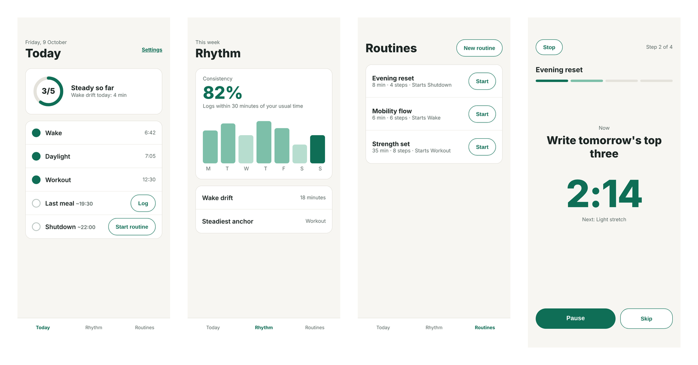
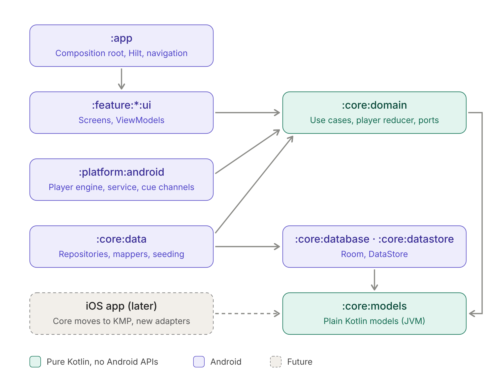
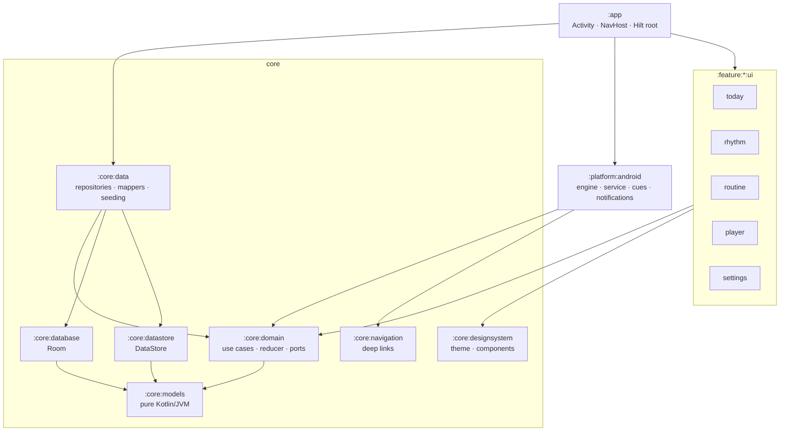
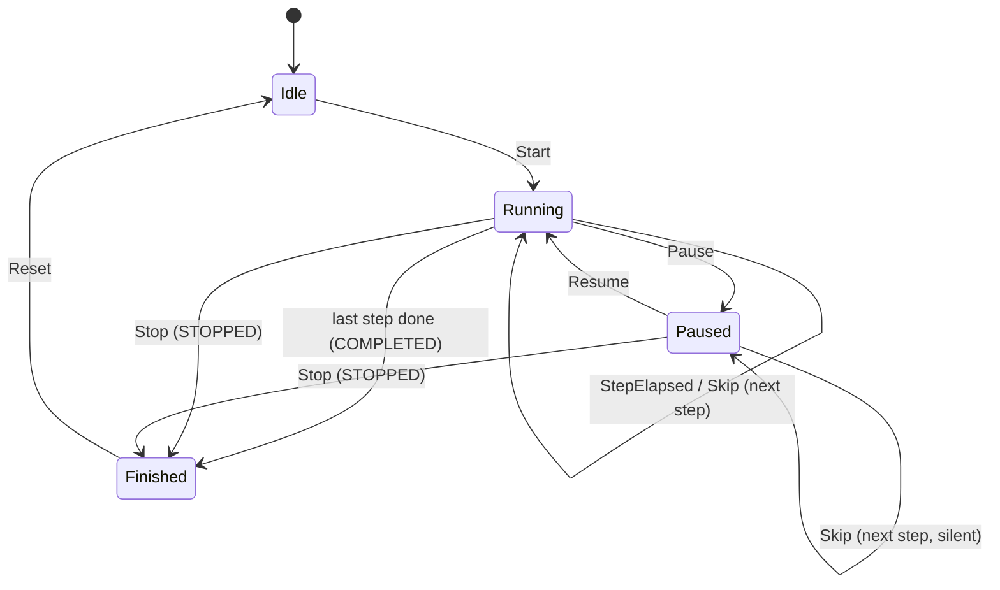
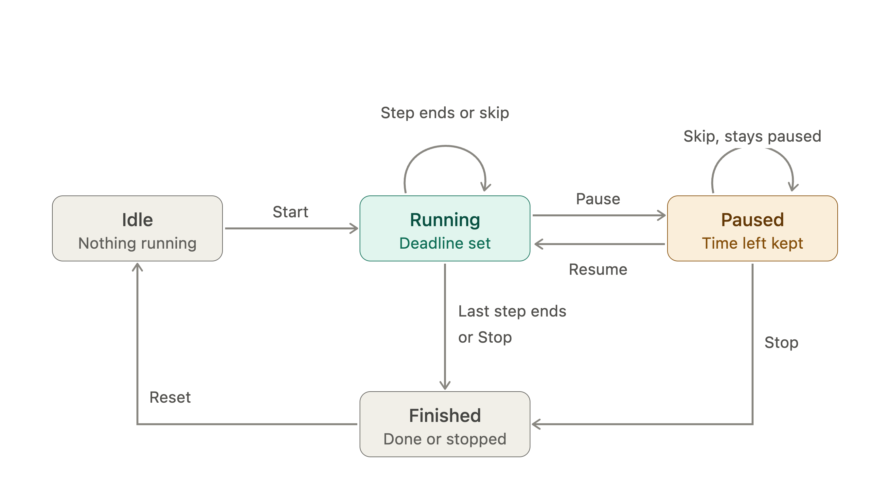
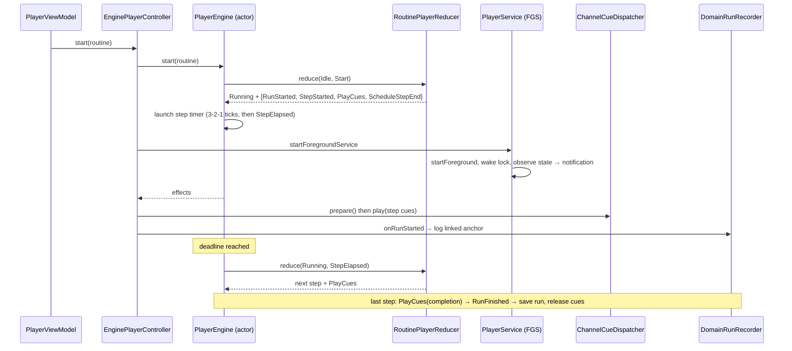

# Ritune

**A daily-rhythm app for Android.** Log the anchors of your day (wake, morning light, movement, last meal, screens off, lights out) and run guided routines with haptic, sound and spoken cues that keep working with the screen off.

[](https://github.com/Tanvi-Goyal/Ritune/actions/workflows/ci.yml)
[](https://github.com/Tanvi-Goyal/Ritune/releases/latest)


[](LICENSE)



## Features
Ritune is built around one loop. Log the day, see the pattern, then change it with a routine.

- **Today**: one tap logs an anchor, with undo. A ring shows the day's progress.
- **Rhythm**: weekly consistency per anchor. A log counts as steady when it falls within 30 minutes of that anchor's median time.
- **Routines**: create, edit and reorder steps. A routine can be linked to an anchor, and starting it logs that anchor.
- **Guided player**: step timer with pause, resume, skip and stop. It survives the screen turning off and process backgrounding, and has an ongoing notification with actions.
- **Cues**: a haptic pattern, a bell and the spoken step name at each step, a 3-2-1 countdown, and a completion chime. Each one can be turned on or off, and changes apply mid-run.
- **Settings**: cue toggles, theme, and delete all data.
- **Starter content**: six circadian anchors, from a steady wake time to a steady bedtime, and seven short built-in routines (morning start, light walk, 20-minute strength, close the kitchen, evening reset, wind down, focus block). All are seeded from `DefaultCatalog` on first launch and after "Delete all data".

## Tech stack

| Area | Choice |
|---|---|
| UI | Jetpack Compose, Material 3, a custom design system module, light and dark themes |
| Architecture | Clean Architecture, unidirectional data flow (state, events and one-off effects per screen) |
| Async | Coroutines and Flow (`StateFlow`, `stateIn`, channels, an actor) |
| DI | Hilt, including multibindings (`@IntoSet` cue channels) |
| Persistence | Room 3 (relational data), Preferences DataStore (settings, onboarding) |
| Navigation | Navigation Compose with type-safe `@Serializable` routes, nested graphs and deep links |
| Platform | Foreground service (`specialUse`), wake lock, notifications with a chronometer, `Vibrator`, `SoundPool`, `TextToSpeech`, audio focus |
| Time | `kotlinx-datetime`, `kotlin.time`, and monotonic time (`elapsedRealtime`) for timers |
| Testing | JUnit, coroutines-test and Turbine with shared fakes; Robolectric Compose tests; Roborazzi screenshot tests; Room, navigation, service and end-to-end tests on a Gradle Managed Device; Kover coverage. See [docs/testing.md](docs/testing.md) |
| CI/CD | GitHub Actions: lint, unit, screenshot and device tests, coverage and a debug build on every PR. Running the Release workflow with a version builds a signed, R8-optimized APK and AAB, uploads the AAB to Play internal testing as a draft, and publishes a tagged GitHub Release. Dependabot keeps dependencies current |

---

## Architecture (HLD)

The dependency rule points inward. Features know only the domain, the domain knows only models, and Android-specific code sits behind ports (interfaces) that the outer modules implement.




| Layer | Responsibility | Never depends on |
|---|---|---|
| `:core:models` | Plain data: `Routine`, `Step`, `Cue`, `PlayerState`, ... (a JVM-only module) | Android |
| `:core:domain` | Use cases, the player reducer, and **ports** (`PlayerController`, `CuePlayer`, `RunRecorder`, repositories) | Data, platform, UI |
| `:core:data` | Implements the repositories on Room and DataStore, and maps entities to models | Features, platform |
| `:platform:android` | Implements the player and cue ports with Android services | Features, `:core:data` |
| `:feature:*:ui` | Compose screens and ViewModels, one module per feature | Other features, data, platform |
| `:app` | Wires everything together: Hilt graph, navigation host, theme | n/a |

---

## Low-level design

### 1. The player: a pure reducer driven by an actor

The player is a state machine with no clocks or Android in it. `RoutinePlayerReducer` is a pure function:

```kotlin
(PlayerState, PlayerEvent) -> Transition(newState, effects)
```

`PlayerEngine` owns the only mutable copy of the state. Commands are processed one at a time through a channel (an actor), so pause, skip and timer events can never race. Effects describe what should happen, the engine and controller carry them out.



### 2. Starting a routine, end to end




---

## Engineering decisions

| Decision | Why |
|---|---|
| Pure reducer + effects for the player | Every transition is a pure function, which is deterministic and unit-testable, and Android side effects stay at the edges |
| Monotonic deadlines instead of tickers | No drift and no work every second. It is correct across pause, resume and a sleeping CPU (with a wake lock while running) |
| The engine is a process singleton; the service only observes | The UI drives the run directly. The service exists to keep the process alive and the notification current, not to own state |
| Ports in the domain (`PlayerController`, `CuePlayer`, `RunRecorder`) | Features never see Android services, and the platform can be swapped or faked |
| One module per feature, features never depend on each other | Navigation between features is wired in `:app` through callbacks |
| `specialUse` foreground service type | The honest category for a user-started guided timer on Android 14+ |

## Design system

`:core:designsystem` holds the foundations: color, type, shape, spacing, motion and the light and dark themes. Screens never hardcode values, colors, text styles and spacing all come from the theme, and `docs/tokens.json` is the source of truth that `Color.kt` mirrors.

See [docs/design_system.md](docs/design_system.md) for the rules, dark theme and computed WCAG contrast.

## Navigation

A single activity with Navigation Compose and type-safe `@Serializable` routes. Features declare their own graphs and never import each other; `:app` wires them together.

See [docs/navigation.md](docs/navigation.md) for the routes, back stack rules, key flows and how to add a screen.

## Testing

Ritune has no QA team, so the tests are the QA. Every pull request runs JVM and Robolectric tests (logic, ViewModels, Compose behavior, Roborazzi screenshots) and device tests (Room, navigation, the foreground service, end-to-end journeys) on a Gradle Managed Device. Release journeys run on an emulator before each release.

See [docs/testing.md](docs/testing.md) for the test pyramid, commands, and what each kind of change needs.

## Performance

Performance is measured before anything changes. Results come from release builds on two physical phones, a mid-range Redmi Note 10 Pro and a flagship Pixel 9 Pro, covering cold start, Macrobenchmark journeys and Baseline Profiles.

See [docs/performance.md](docs/performance.md) for the methodology, results and commands to reproduce them.

## Project structure

```
app/                    Activity, NavHost, top-level navigation, theme root
core/
  models/               Pure Kotlin domain models (JVM module)
  domain/               Use cases, RoutinePlayerReducer, ConsistencyCalculator, ports
  data/                 Repository implementations, mappers, DatabaseSeeder
  database/             Room entities, DAOs, relations
  datastore/            DataStore instances
  designsystem/         Theme, typography, motion, shared components
  navigation/           Deep-link constants shared by the app and the platform
  testing/              Shared fakes, rules and test data for every module's tests
  screenshot-testing/   Roborazzi capture helpers for Compose screenshot tests
platform/android/       PlayerEngine, PlayerService, notifications, cues/
feature/<name>/ui/      today · rhythm · routine · player · settings · onboarding
build-logic/            Gradle convention plugins shared by every module
journeys/               Release journeys run on an emulator before each release
docs/screenshots/       Images used in this README
```

## Release Automation
Release is automated in GitHub Actions. Every pull request runs lint, unit, screenshot and device tests and builds the R8-optimised release. A manual Release workflow takes a version, builds a signed APK and AAB, uploads the AAB to Play's internal track as a draft and publishes a GitHub Release.

## Build and run

**Just want to try it?** Download `app-release.apk` from the [latest release](https://github.com/Tanvi-Goyal/Ritune/releases/latest) and install it on an Android 8.0+ device.

To build from source, you need: Android Studio (recent stable), JDK 17, an Android SDK with API 37.

```bash
git clone https://github.com/Tanvi-Goyal/Ritune.git && cd Ritune
./gradlew :app:installDebug
```

Cues are best checked on a physical device, since emulators don't vibrate. The sounds in `platform/android/src/main/res/raw` are synthesized placeholders.

## License

Released under the [MIT License](LICENSE).
