# Ritune

**A daily-rhythm app for Android.** Log the anchors of your day (wake, daylight, workout, last meal, shutdown) and run guided routines with haptic, sound and spoken cues that keep working with the screen off.

Built as a portfolio project to practise production Android: a modular Clean Architecture codebase, a pure state-machine player, a foreground service, and Android media APIs, all in Kotlin and Jetpack Compose.


| Today | Rhythm | Routines | Editor |
|:---:|:---:|:---:|:---:|
| 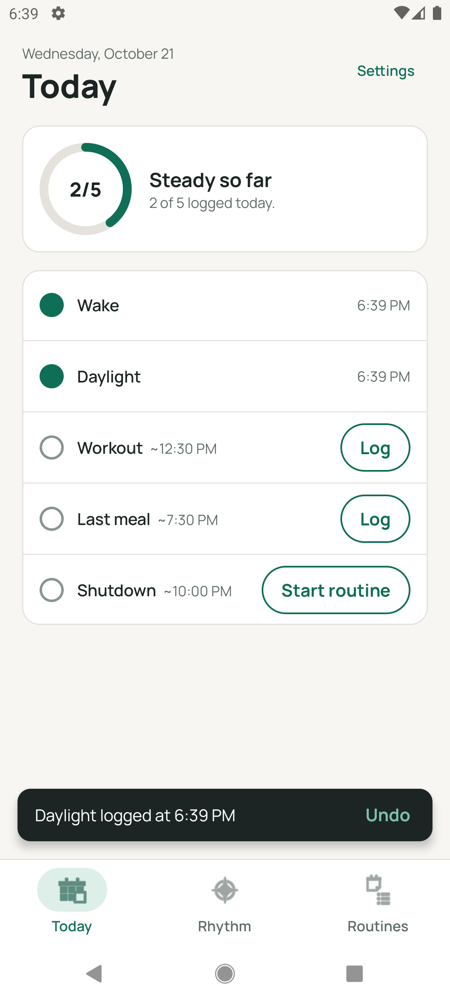 | 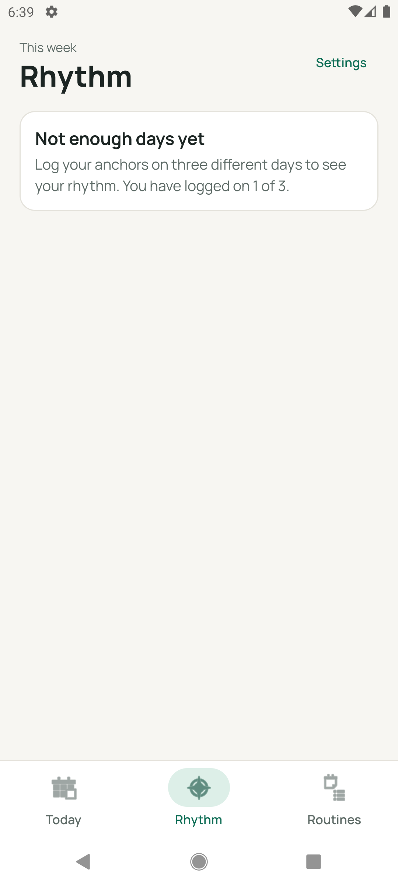 | 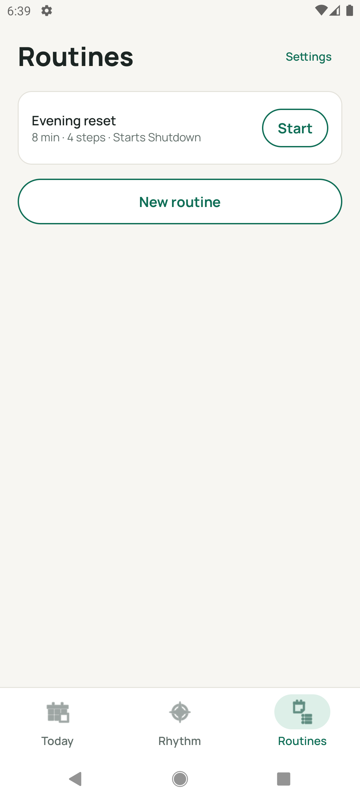 | 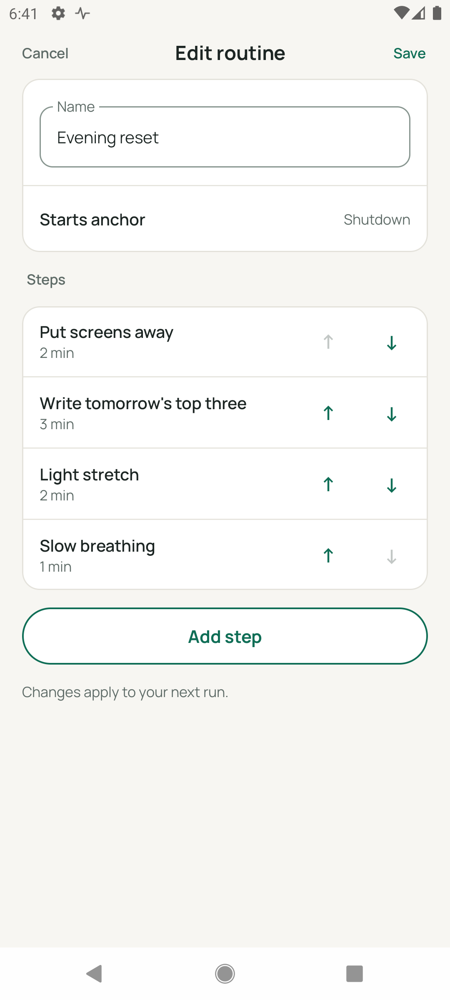 |
| **Player** | **Player (dark)** | **Routine detail** | **Settings** |
| 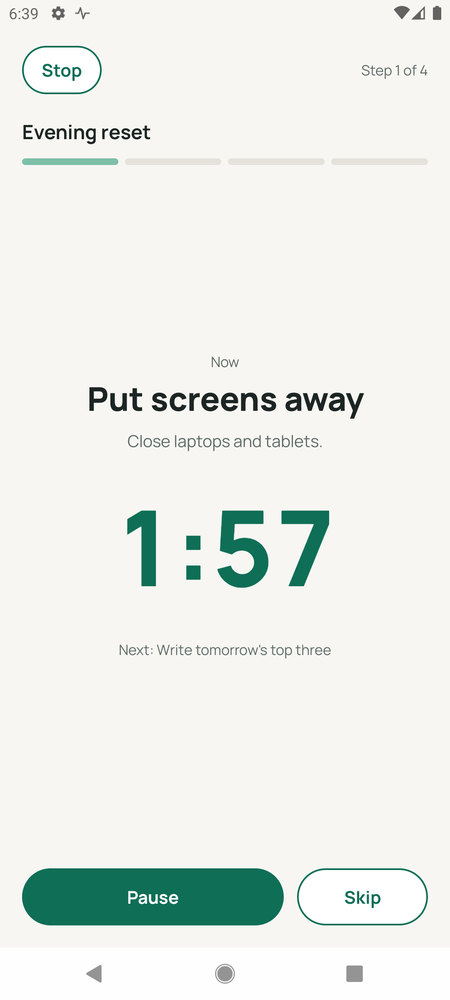 | 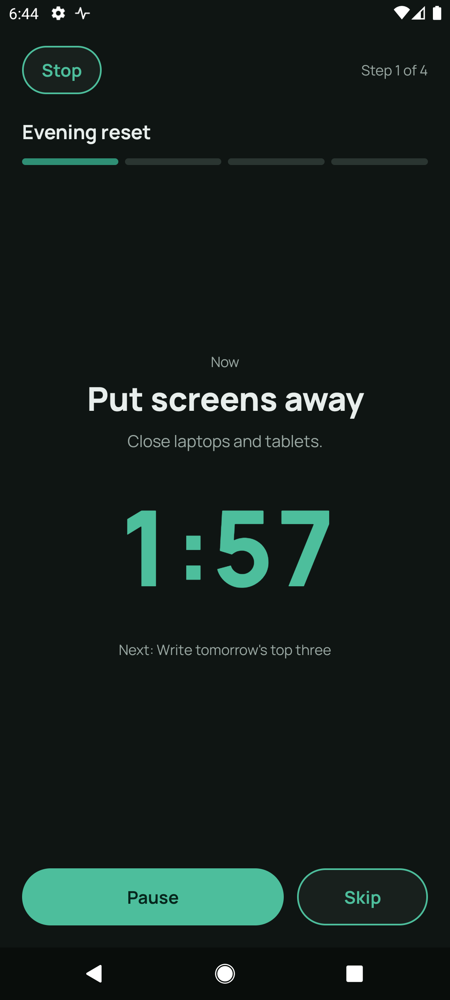 | 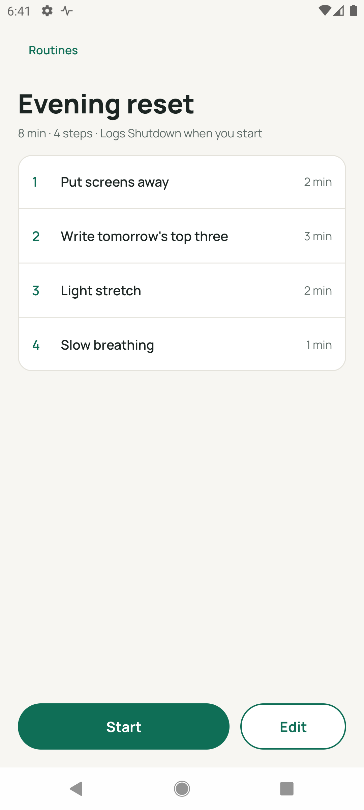 | 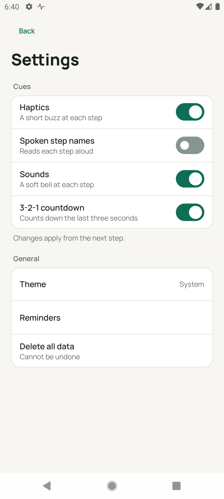 |

---

## Features

- **Today**: one tap logs an anchor, with undo. A ring shows the day's progress.
- **Rhythm**: weekly consistency per anchor. A log counts as steady when it falls within 30 minutes of that anchor's median time.
- **Routines**: create, edit and reorder steps. A routine can be linked to an anchor, and starting it logs that anchor.
- **Guided player**: step timer with pause, resume, skip and stop. It survives the screen turning off and process backgrounding, and has an ongoing notification with actions.
- **Cues**: a haptic pattern, a bell and the spoken step name at each step, a 3-2-1 countdown, and a completion chime. Each one can be turned on or off, and changes apply mid-run.
- **Settings**: cue toggles, theme, and delete all data.

## Tech stack

| Area | Choice |
|---|---|
| UI | Jetpack Compose, Material 3, a custom design system module, light and dark themes |
| Architecture | Clean Architecture, unidirectional data flow (state, events and one-off effects per screen) |
| Async | Coroutines and Flow (`StateFlow`, `stateIn`, channels, an actor) |
| DI | Hilt, including multibindings (`@IntoSet` cue channels) |
| Persistence | Room 3 (relational data), Preferences DataStore (settings, onboarding) |
| Navigation | Navigation Compose with type-safe `@Serializable` routes, nested graphs and deep links |
| Platform | Foreground service (`specialUse`), wake lock, notifications with a chronometer, `Vibrator`, `SoundPool`, `TextToSpeech`, audio focus |
| Time | `kotlinx-datetime`, `kotlin.time`, and monotonic time (`elapsedRealtime`) for timers |

---

## Architecture (HLD)

The dependency rule points inward. Features know only the domain, the domain knows only models, and Android-specific code sits behind ports (interfaces) that the outer modules implement.

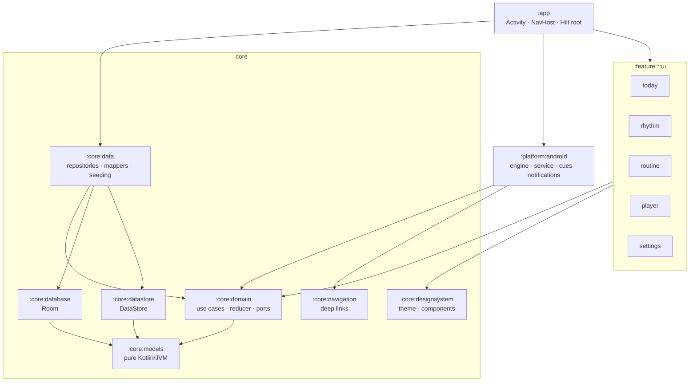

| Layer | Responsibility | Never depends on |
|---|---|---|
| `:core:models` | Plain data: `Routine`, `Step`, `Cue`, `PlayerState`, ... (a JVM-only module) | Android |
| `:core:domain` | Use cases, the player reducer, and **ports** (`PlayerController`, `CuePlayer`, `RunRecorder`, repositories) | Data, platform, UI |
| `:core:data` | Implements the repositories on Room and DataStore, and maps entities to models | Features, platform |
| `:platform:android` | Implements the player and cue ports with Android services | Features, `:core:data` |
| `:feature:*:ui` | Compose screens and ViewModels, one module per feature | Other features, data, platform |
| `:app` | Wires everything together: Hilt graph, navigation host, theme | n/a |

---

## Low-level design

### 1. The player: a pure reducer driven by an actor

The player is a state machine with no clocks or Android in it. `RoutinePlayerReducer` is a pure function:

```kotlin
(PlayerState, PlayerEvent) -> Transition(newState, effects)
```

`PlayerEngine` owns the only mutable copy of the state. Commands are processed one at a time through a channel (an actor), so pause, skip and timer events can never race. Effects describe what should happen; the engine and controller carry them out.

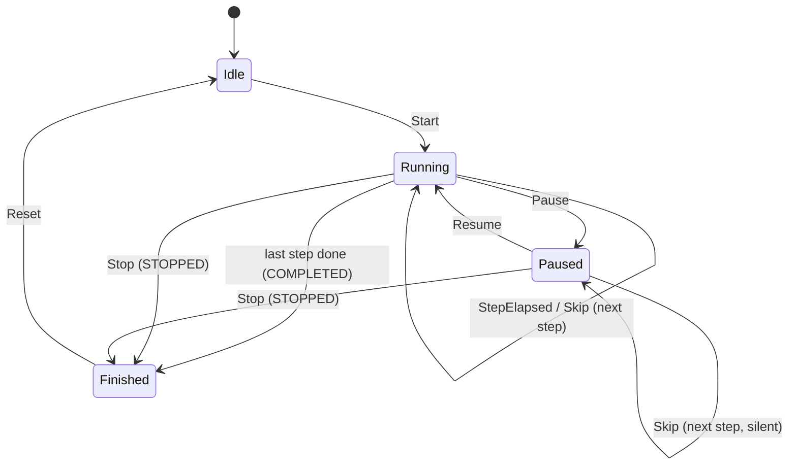

Time is stored as an **absolute monotonic deadline** while running and as a **remaining duration** while paused, so nothing ticks every second. The UI computes the remaining time, and the notification uses a system chronometer.

### 2. Starting a routine, end to end

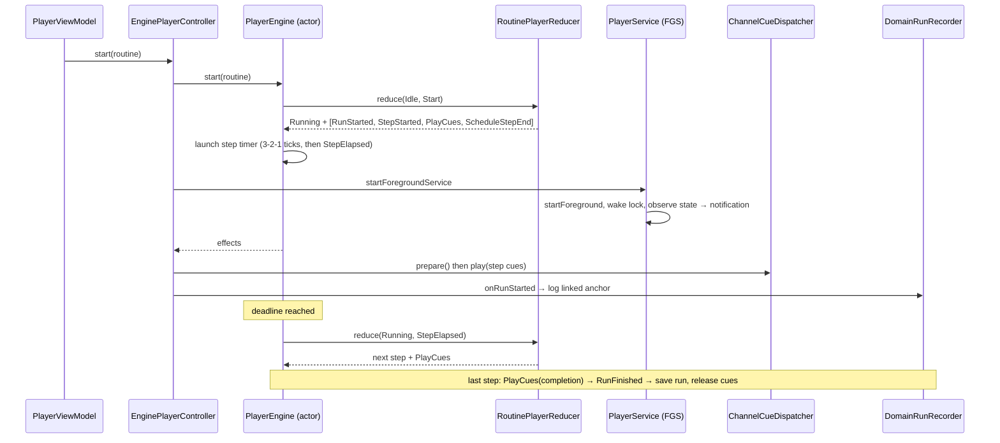

### 3. Cue pipeline

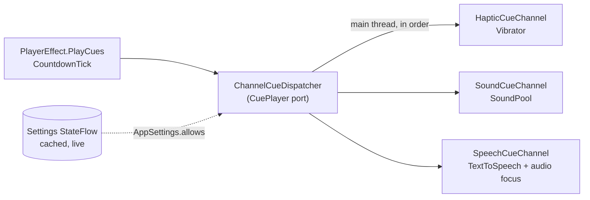

- **The domain decides what plays; the platform decides how.** The reducer emits which cues fire, so the rules can be tested without a device.
- **Gating happens in one place.** `AppSettings.allows(cue)` is checked against a cached `StateFlow`, so changing a toggle mid-run takes effect at the next cue without a disk read.
- **Channels are a `Set<CueChannel>` built by Hilt multibinding.** A new channel is one class plus one binding.
- **They handle Android's async startup.** SoundPool and TTS both load asynchronously, so a cue requested before its channel is ready is queued, not dropped. Speech takes transient may-duck audio focus so the user's music dips instead of stopping.

### 4. Data model

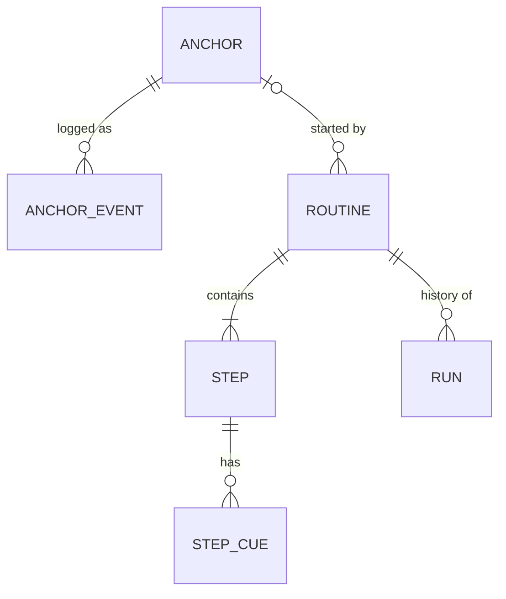

Anchor events store the instant **and** the UTC offset, so a log keeps its local time of day after time-zone travel. Settings and onboarding live in DataStore, not Room.

---

## Engineering decisions worth a look

| Decision | Why |
|---|---|
| Pure reducer + effects for the player | Every transition is a pure function, which is deterministic and unit-testable, and Android side effects stay at the edges |
| Monotonic deadlines instead of tickers | No drift and no work every second. It is correct across pause, resume and a sleeping CPU (with a wake lock while running) |
| The engine is a process singleton; the service only observes | The UI drives the run directly. The service exists to keep the process alive and the notification current, not to own state |
| Ports in the domain (`PlayerController`, `CuePlayer`, `RunRecorder`) | Features never see Android services, and the platform can be swapped or faked |
| One module per feature, features never depend on each other | Navigation between features is wired in `:app` through callbacks |
| `specialUse` foreground service type | The honest category for a user-started guided timer on Android 14+ |

## Project structure

```
app/                    Activity, NavHost, top-level navigation, theme root
core/
  models/               Pure Kotlin domain models (JVM module)
  domain/               Use cases, RoutinePlayerReducer, ConsistencyCalculator, ports
  data/                 Repository implementations, mappers, DatabaseSeeder
  database/             Room entities, DAOs, relations
  datastore/            DataStore instances
  designsystem/         Theme, typography, motion, shared components
  navigation/           Deep-link constants shared by the app and the platform
platform/android/       PlayerEngine, PlayerService, notifications, cues/
feature/<name>/ui/      today · rhythm · routine · player · settings · onboarding
docs/screenshots/       Images used in this README
```

## Build and run

Requirements: Android Studio (recent stable), JDK 17, an Android SDK with API 37.

```bash
git clone <repo-url> && cd Ritune
./gradlew :app:installDebug
```

Cues are best checked on a physical device, since emulators don't vibrate. The sounds in `platform/android/src/main/res/raw` are synthesized placeholders.

## Roadmap

- [ ] Onboarding flow (the route exists; it's a placeholder for now)
- [ ] Anchor reminders (notifications at target times)
- [ ] Unit tests for the reducer, the consistency calculator and the engine's virtual-time countdown; UI tests for the main flows
- [ ] Home-screen widget for one-tap anchor logging (`EventSource.WIDGET` is already modelled)
- [ ] Health Connect import (`EventSource.HEALTH_IMPORT`)
- [ ] CI with GitHub Actions (build, lint, tests)
