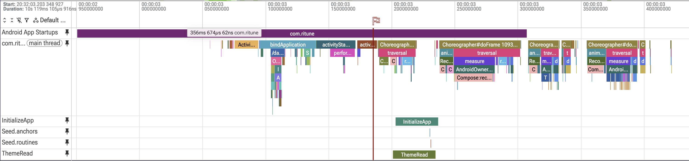

# Performance

Ritune measures performance before it changes anything. Every result in this file says what device it ran on, which build, which compilation state and how many iterations, so anyone can reproduce it.

This file has three parts:

1. **[Methodology](#methodology)**: how measurements are taken.
2. **[Results](#results)**: numbers, newest first, one section per phase.
3. **[Commands](#commands)**: copy-paste steps to reproduce each measurement.

## Methodology

### Device

Published numbers come from two physical phones, one mid-range and one flagship, so results show both ends of the range Ritune's users have. Each result names its device. Emulators and the CI managed device (`pixel6Api34`) only check that benchmarks run; their timings are never published.

| Property | Redmi Note 10 Pro | Pixel 9 Pro |
|---|---|---|
| Model / codename | M2101K6P (`sweetin`) | Pixel 9 Pro (`caiman`) |
| Device class | Mid-range (2021) | Flagship (2024) |
| Chip | Qualcomm SM7150 (Snapdragon 732G) | Google Tensor G4 |
| RAM | 6 GB | 16 GB |
| Android version / API level | 12 / 31 | 17 / 37 |
| Refresh rate | 60 or 120 Hz; currently set to 60 Hz | Adaptive, up to 120 Hz |

The frame deadline depends on the refresh rate: 16.7 ms at 60 Hz, 8.3 ms at 120 Hz. Record each phone's refresh rate setting with every frame result, and don't change it between a before and an after run.

The Redmi is the primary device. It is closer to a typical user's phone, and slow code shows up there first.

### Build

| Property | Value |
|---|---|
| Build type | `release`, with R8 optimization on |
| Signing | Release keystore, from the `RITUNE_KEYSTORE_*` environment variables |
| Debuggable | No. A debuggable build turns off many ART optimizations, so debug timings are never published. |
| Commit | The commit hash goes next to each result |

### Compilation state

Startup speed depends heavily on how much of the app is compiled to machine code, so every result names its state.

| State | How it is set | Real user it simulates |
|---|---|---|
| None (day one) | `adb shell cmd package compile -m verify -f com.ritune`, or `CompilationMode.None()` | First launch after an install or update, with no profile |
| Baseline Profile | `CompilationMode.Partial(BaselineProfile.Require)` (from Phase 3) | First launch, with a shipped Baseline Profile |
| Speed profile | `adb shell cmd package compile -m speed-profile -f com.ritune` after several launches, or `CompilationMode.Partial(warmupIterations = N)` | A user days later, after background dexopt or cloud profiles |

`CompilationMode.Full()` compiles everything. No real user's phone is in that state, so it is never published as a result.

Always check the state before a run, and record it with the result:

```bash
adb shell dumpsys package dexopt | grep -A2 "\[com.ritune\]" | grep -o "status=[a-z-]*\] \[reason=[a-z-]*"
```

**Xiaomi (MIUI) ignores `cmd package compile` from adb.** It prints `Success`, but logcat shows `Skipped dexOpt for start by shell` and the state doesn't change. On the Redmi, set the state the way a real phone gets it:

| State | How to set it on MIUI | Expected `dumpsys` state |
|---|---|---|
| None (day one) | `adb uninstall com.ritune`, then install the APK again | `status=verify [reason=install]` |
| Speed profile | Use the app for 1–2 minutes, then `adb shell cmd package bg-dexopt-job com.ritune` (the same background job that compiles apps overnight) | `status=speed-profile [reason=bg-dexopt]` |

### Conditions

- Phone on charge and cool to the touch. Rest it between suites to avoid thermal throttling.
- Brightness fixed, auto-rotate off, Wi-Fi on, other apps force-stopped.
- Same app data for every run. Record whether the database was freshly seeded.

### Iterations and reporting

- Startup: at least 10 runs for a manual check, and 20–30 when claiming an improvement.
- Report the median (P50) with the min–max range. Frame metrics also report P90 and P99.
- A change counts as an improvement only if it is larger than the run-to-run spread. To isolate one piece of work, measure its trace section directly as well as the end-to-end number.
- Report end-to-end changes as the headline, and section changes as the explanation. Only work on the critical path changes what the user feels.

### Metrics

| Metric | Meaning | Source |
|---|---|---|
| TTID | Time until `MainActivity` draws its first frame. Includes everything the splash waits for (`InitializeApp` → `DatabaseSeeder`, and the theme DataStore read). | `TotalTime` from `am start -W`, or `timeToInitialDisplayMs` |
| TTFD | Time until Today leaves its `Loading` state, reported by `ReportDrawnWhen` in `TodayScreen` | The `reportFullyDrawn()` slice in a trace, or `timeToFullDisplayMs` (Phase 2) |
| Frame overrun | How far each frame finished past its deadline (negative means early) | `FrameTimingMetric` (Phase 2) |

### Trace sections

Ritune writes these sections into system traces. Their names are stable, because queries and benchmarks look them up by name.

| Section | Where | Type | Measures |
|---|---|---|---|
| `InitializeApp` | `MainViewModel` | Async | Startup initialization, which the splash waits on |
| `ThemeRead` | `AppThemeViewModel` | Async, ends at the first value | The first theme read, which the splash also waits on |
| `Seed.anchors`, `Seed.routines` | `DatabaseSeeder`, inside the write transaction | Async | Counting, and seeding when empty |
| `Player.notify` | `PlayerService` | Sync | Each ongoing-notification rebuild during a run |

Sections around `suspend` calls must be async: a sync section would be closed by whichever thread the coroutine resumes on.

## Results

### Phase 1: cold-start trace

One cold start per phone, recorded with [`perf/cold-start.pftxt`](perf/cold-start.pftxt) and summarised with [`perf/cold-start.sql`](perf/cold-start.sql). Release build, 2026-10-30. Compilation state: Redmi `speed-profile` (MIUI compiled it after the install), Pixel `verify`, so compare structure across phones, not absolute times.

| Milestone (ms from launch) | Redmi Note 10 Pro | Pixel 9 Pro |
|---|---|---|
| `bindApplication` starts | 144.4 | 72.0 |
| `activityStart` starts | 189.8 | 85.7 |
| `activityResume` ends | 237.9 | 107.4 |
| `ThemeRead` | 250.5 → 284.2 (33.7) | 115.6 → 124.0 (8.4) |
| `InitializeApp` | 252.5 → 286.4 (33.9) | 116.5 → 127.9 (11.4) |
| `Seed.anchors` starts | 279.5 | 127.1 |
| TTID | 356.7 | 151.8 |
| TTFD | 440.0 | 198.9 |
| TTID frame | 64.2 ms (3 missed at 60 Hz) | 20.3 ms (2 missed at 120 Hz) |




Findings:

- **Opening the Room database is most of `InitializeApp`:** 27 of 34 ms on the Redmi, 10.6 of 11.4 ms on the Pixel. Seeding an already-seeded database takes under 1 ms.
- **The startup work begins late.** Both ViewModels are created during the first `Choreographer#doFrame`, 61 ms (Redmi) and 30 ms (Pixel) after `activityStart` begins, because `by viewModels()` is lazy.
- **`ThemeRead` and `InitializeApp` take about the same time**, so shortening only one saves at most the 2–4 ms between them.
- **Today adds 83 ms (Redmi) and 47 ms (Pixel) between TTID and TTFD.** Its queries only start once Today is composed, after the splash ends.
- **The TTID frame is the most expensive frame:** 64 ms on the Redmi, half of it in `measure`, for the first composition of the app shell and Today.
- **40% of the Redmi's TTID passes before `bindApplication`**, while the system creates the process.

### Phase 0: manual cold start

The first number before any instrumentation exists. TTID only; TTFD comes in Phase 1.

| Date | Commit | Device | Compilation state | Runs | TTID median | TTID range |
|---|---|---|---|---|---|---|
| 2026-10-30 | `21a33c7` | Redmi Note 10 Pro | None (day one) | 10 | 377 ms | 349–607 ms |
| 2026-10-30 | `21a33c7` | Redmi Note 10 Pro | Speed profile (`bg-dexopt`) | 10 | 321 ms | 306–497 ms |
| 2026-10-29 | `4c50885` | Pixel 9 Pro | None (day one) | 10 | 133 ms | 125–151 ms |
| 2026-10-29 | `4c50885` | Pixel 9 Pro | Speed profile | 10 | 115.5 ms | 106–130 ms |

## Commands

### Manual cold start (Phase 0)

Measure the same artifact users get: a release APK signed with the release key. Build it one of two ways.

**From the command line** (reproducible, and matches `release.yml`). Gradle reads the signing details from `RITUNE_KEYSTORE_PATH`, `RITUNE_KEYSTORE_PASSWORD`, `RITUNE_KEY_ALIAS` and `RITUNE_KEY_PASSWORD`. Without them it builds `app-release-unsigned.apk`, which won't install.

```bash
./gradlew :app:assembleRelease
APK=app/build/outputs/apk/release/app-release.apk
```

**From Android Studio** (Build > Generate Signed App Bundle or APK > APK > release). The wizard writes to `app/release/`:

```bash
APK=app/release/app-release.apk
```

Before measuring, confirm the APK is release-signed and not debuggable:

```bash
BT=~/Library/Android/sdk/build-tools/36.0.0
$BT/apksigner verify --print-certs $APK | grep "certificate DN"   # expect CN=Tanvi Goyal, OU=Ritune
$BT/aapt dump badging $APK | grep debuggable                      # expect no output
adb install -r $APK
```

If the install fails with `INSTALL_FAILED_UPDATE_INCOMPATIBLE`, a debug build is on the phone. Run `adb uninstall com.ritune` first.

Day one (no compiled code):

```bash
adb shell cmd package compile -m verify -f com.ritune

for i in $(seq 1 10); do
  adb shell am force-stop com.ritune; sleep 3
  adb shell am start -W -n com.ritune/.MainActivity | grep TotalTime
done
```

After several launches, compile from the recorded profile and repeat the loop:

```bash
adb shell cmd package compile -m speed-profile -f com.ritune
```

`force-stop` before each launch makes every run a cold start.

### Both phones at once

With more than one phone connected, adb needs a serial (`-s`) on every command. A phone on wireless debugging shows `ip:port`, and the port changes each time you reconnect, so look phones up by codename:

```bash
REDMI=$(adb devices -l | awk '/sweetin/{print $1}')
PIXEL=$(adb devices -l | awk '/caiman/{print $1}')

for s in $REDMI $PIXEL; do
  adb -s $s install -r $APK
done

coldstart() {  # usage: coldstart <serial> <label>
  adb -s "$1" shell cmd package compile -m verify -f com.ritune
  for i in $(seq 1 10); do
    adb -s "$1" shell am force-stop com.ritune; sleep 3
    adb -s "$1" shell am start -W -n com.ritune/.MainActivity | grep TotalTime | sed "s/^/$2 /"
  done
}

coldstart $REDMI redmi & coldstart $PIXEL pixel & wait
```

Running both phones in parallel is safe: `TotalTime` is measured on each phone, so the shared Mac and USB connection don't affect it. `TotalTime` is TTID in milliseconds.

### Cold-start trace (Phase 1)

Records one cold start into a Perfetto trace, on one phone or both at once. It uses Perfetto's official [`record_android_trace`](https://perfetto.dev/docs/quickstart/android-tracing) script; download it once:

```bash
mkdir -p ~/.local/share/perfetto-tools
curl -o ~/.local/share/perfetto-tools/record_android_trace \
  https://raw.githubusercontent.com/google/perfetto/main/tools/record_android_trace
chmod +x ~/.local/share/perfetto-tools/record_android_trace
```

Record, after installing the release APK (see above):

```bash
REC=~/.local/share/perfetto-tools/record_android_trace
CFG=docs/perf/cold-start.pftxt
OUT=~/perfetto-traces/ritune; mkdir -p $OUT

coldtrace() {   # usage: coldtrace <serial> <name>
  adb -s $1 shell dumpsys package dexopt | grep -A2 "\[com.ritune\]" | grep -o "status=[a-z-]*" | sed "s/^/$2 /"
  adb -s $1 shell am force-stop com.ritune
  $REC -c $CFG --serial $1 -n -o $OUT/$2-cold-start.perfetto-trace &
  sleep 3   # give tracing time to start
  adb -s $1 shell am start -W -n com.ritune/.MainActivity | grep TotalTime | sed "s/^/$2 /"
  wait
}

coldtrace $REDMI redmi & coldtrace $PIXEL pixel & wait
```

Open a trace in the [Perfetto UI](https://ui.perfetto.dev) (Open trace file), or summarise it with `trace_processor`:

```bash
trace_processor query -f docs/perf/cold-start.sql ~/perfetto-traces/ritune/redmi-cold-start.perfetto-trace
```

The summary lists the lifecycle, Ritune's sections, TTID and TTFD in ms from launch, then every main-thread frame up to TTFD with its missed 60 Hz and 120 Hz deadlines.
