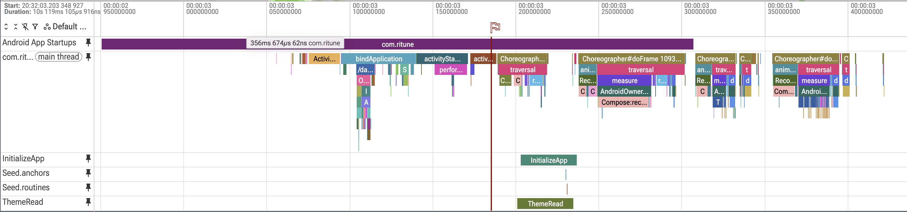
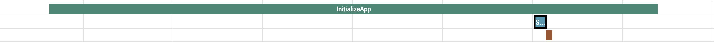

# Performance

Ritune measures performance before it changes anything. Every result in this file says what device it ran on, which build, which compilation state and how many iterations, so anyone can reproduce it.

This file has three parts:

1. **[Methodology](#methodology)**: how measurements are taken.
2. **[Results](#results)**: numbers, newest first, one section per phase.
3. **[Commands](#commands)**: copy-paste steps to reproduce each measurement.

## Methodology

### Device

Published numbers come from two physical phones, one mid-range and one flagship, so results show both ends of the range Ritune's users have. Each result names its device. Emulators and the CI managed device (`pixel6Api34`) only check that benchmarks run; their timings are never published.

| Property | Redmi Note 10 Pro | Pixel 9 Pro |
|---|---|---|
| Model / codename | M2101K6P (`sweetin`) | Pixel 9 Pro (`caiman`) |
| Device class | Mid-range (2021) | Flagship (2024) |
| Chip | Qualcomm SM7150 (Snapdragon 732G) | Google Tensor G4 |
| RAM | 6 GB | 16 GB |
| Android version / API level | 12 / 31 | 17 / 37 |
| Refresh rate | 60 or 120 Hz; currently set to 60 Hz | Adaptive, up to 120 Hz |

The frame deadline depends on the refresh rate: 16.7 ms at 60 Hz, 8.3 ms at 120 Hz. Record each phone's refresh rate setting with every frame result, and don't change it between a before and an after run.

The Redmi is the primary device. It is closer to a typical user's phone, and slow code shows up there first.

### Build

| Property | Value |
|---|---|
| Build type | `release`, with R8 optimization on |
| Signing | Release keystore, from the `RITUNE_KEYSTORE_*` environment variables |
| Debuggable | No. A debuggable build turns off many ART optimizations, so debug timings are never published. |
| Commit | The commit hash goes next to each result |

### Compilation state

Startup speed depends heavily on how much of the app is compiled to machine code, so every result names its state.

| State | How it is set | Real user it simulates |
|---|---|---|
| None (day one) | `adb shell cmd package compile -m verify -f com.ritune`, or `CompilationMode.None()` | First launch after an install or update, with no profile |
| Baseline Profile | On MIUI: `compile=bgdexopt` (profileinstaller's install broadcast, then `bg-dexopt-job`), before the app runs. Elsewhere: `CompilationMode.Partial(BaselineProfile.Require)` | First launch after a Play install, which compiles the shipped Baseline Profile |
| Speed profile | `adb shell cmd package compile -m speed-profile -f com.ritune` after several launches, or `CompilationMode.Partial(warmupIterations = N)` | A user days later, after background dexopt or cloud profiles |

`CompilationMode.Full()` compiles everything. No real user's phone is in that state, so it is never published as a result.

Always check the state before a run, and record it with the result:

```bash
adb shell dumpsys package dexopt | grep -A2 "\[com.ritune\]" | grep -o "status=[a-z-]*\] \[reason=[a-z-]*"
```

**Xiaomi (MIUI) ignores `cmd package compile` from adb.** It prints `Success`, but logcat shows `Skipped dexOpt for start by shell` and the state doesn't change. On the Redmi, set the state the way a real phone gets it:

| State | How to set it on MIUI | Expected `dumpsys` state |
|---|---|---|
| None (day one) | `adb uninstall com.ritune`, then install the APK again | `status=verify [reason=install]` |
| Speed profile | Use the app for 1–2 minutes, then `adb shell cmd package bg-dexopt-job com.ritune` (the same background job that compiles apps overnight) | `status=speed-profile [reason=bg-dexopt]` |

### Conditions

- Phone on charge and cool to the touch. Rest it between suites to avoid thermal throttling.
- Brightness fixed, auto-rotate off, Wi-Fi on, other apps force-stopped.
- Same app data for every run. Record whether the database was freshly seeded.

### Iterations and reporting

- Startup: at least 10 runs for a manual check, and 20–30 when claiming an improvement.
- Report the median (P50) with the min–max range. Frame metrics also report P90 and P99.
- Only compare runs from the same session. The Redmi's timings can shift between sessions by more than the noise (see Phase 2), so a before and an after run back to back, ideally alternating A, B, A, B, with nothing changed on the phone in between.
- A change counts as an improvement only if it is larger than the run-to-run spread. To isolate one piece of work, measure its trace section directly as well as the end-to-end number.
- Report end-to-end changes as the headline, and section changes as the explanation. Only work on the critical path changes what the user feels.

### Metrics

| Metric | Meaning | Source |
|---|---|---|
| TTID | Time until `MainActivity` draws its first frame. Includes everything the splash waits for (`InitializeApp` → `DatabaseSeeder`, and the theme DataStore read). | `TotalTime` from `am start -W`, or `timeToInitialDisplayMs` |
| TTFD | Time until Today leaves its `Loading` state, reported by `ReportDrawnWhen` in `TodayScreen` | The `reportFullyDrawn()` slice in a trace, or `timeToFullDisplayMs` (Phase 2) |
| Frame overrun | How far each frame finished past its deadline (negative means early) | `FrameTimingMetric` (Phase 2) |

### Trace sections

Ritune writes these sections into system traces. Their names are stable, because queries and benchmarks look them up by name.

| Section | Where | Type | Measures |
|---|---|---|---|
| `InitializeApp` | `MainViewModel` | Async | Startup initialization, which the splash waits on |
| `ThemeRead` | `AppThemeViewModel` | Async, ends at the first value | The first theme read, which the splash also waits on |
| `Seed.anchors`, `Seed.routines` | `DatabaseSeeder`, inside the write transaction | Async | Counting, and seeding when empty |
| `Player.notify` | `PlayerService` | Sync | Each ongoing-notification rebuild during a run |

Sections around `suspend` calls must be async: a sync section would be closed by whichever thread the coroutine resumes on.

## Results

### Phase 3: Baseline Profiles

**The generated Baseline Profile makes cold startup 10% faster to TTFD, 83 ms on the Redmi, once it is compiled.** Scrolling the routines list and opening a routine barely change.

**Setup.** Redmi Note 10 Pro, 60 Hz, session 4 (2026-11-03, 06:31–08:33 UTC, auto-rotate off), `CompilationMode.Ignore()`, 15 iterations per run, seed 21 days / 30 routines.

- **A and B are the same code.** B ships the generated profile in `app/src/main/generated/baselineProfiles`. A is a worktree at the same commit without that folder, so it ships only the rules its libraries bring (Compose, AndroidX).
- **Both states are set inside the test, before measuring:**
  - Day one: Gradle installs the APK fresh, so ART only verifies it.
  - Compiled: `compile=bgdexopt` makes `SeededAppRule` send profileinstaller's install broadcast and then run `bg-dexopt-job`, before the app has run at all. So only the bundled rules get compiled.
- **Order:** for each journey and state, runs alternate A, B, A, B. Each side pools 2 runs, 30 iterations.
- **Validity:** every run's `dexopt-before` matches its `dexopt-after`: `verify / install` for day one, `speed-profile / bg-dexopt` for compiled.

| Journey | State | Metric | A median (P90) | B median (P90) | B vs A |
|---|---|---|---|---|---|
| Cold startup | Compiled | TTID | 513.6 ms (555.9) | 484.6 ms (535.2) | **−29 ms (−5.7%)** |
| Cold startup | Compiled | TTFD | 812.6 ms (918.0) | 729.7 ms (844.1) | **−83 ms (−10.2%)** |
| Cold startup | Compiled | `InitializeApp` | 82.0 ms (92.8) | 70.7 ms (83.3) | **−11 ms (−13.8%)** |
| Cold startup | Day one | TTID | 519.4 ms (556.9) | 522.5 ms (577.4) | +0.6%, within noise |
| Cold startup | Day one | TTFD | 912.7 ms (1027.4) | 971.2 ms (1078.0) | +6.4%, within noise |
| Cold startup | Day one | `InitializeApp` | 75.3 ms (91.7) | 83.2 ms (98.2) | +10.4%, within noise |
| Scroll Routines | Compiled | Frame CPU time | 4.8 ms (6.5) | 4.7 ms (7.4) | −0.9% |
| Scroll Routines | Compiled | Frame overrun P99 | 12.7 ms | 7.6 ms | tail only |
| Scroll Routines | Day one | Frame CPU time | 5.7 ms (6.8) | 5.6 ms (6.7) | −2.5% |
| Open Detail (15 steps) | Compiled | `RoutineDetail.open` | 137.1 ms (156.0) | 133.2 ms (150.5) | −4 ms (−2.8%) |
| Open Detail (15 steps) | Day one | `RoutineDetail.open` | 186.3 ms (198.9) | 181.3 ms (202.4) | −5 ms (−2.7%) |

Each run's median, A1 / A2 against B1 / B2:

| Journey, state | Metric | A runs | B runs |
|---|---|---|---|
| Cold, compiled | TTID | 508.8 / 518.5 | 479.0 / 486.3 |
| Cold, compiled | TTFD | 815.8 / 809.4 | 709.9 / 744.3 |
| Cold, day one | TTFD | 950.8 / 898.7 | 965.2 / 985.9 |
| Open Detail, compiled | `RoutineDetail.open` | 149.0 / 135.1 | 131.9 / 134.5 |
| Open Detail, day one | `RoutineDetail.open` | 185.7 / 187.9 | 177.0 / 184.9 |

Results: `perf/results/2026-11-03-redmi-p3-<journey>-<state>-<A|B><run>/`, for example [cold, compiled, B1](perf/results/2026-11-03-redmi-p3-coldStartup-compiled-B1/).

Findings:

- **Compiled cold startup is the win.** Both B runs beat both A runs on TTID, TTFD and `InitializeApp`, so the gap is larger than the run-to-run spread. Precompiled app code shortens the work the splash waits on (`InitializeApp` −11 ms) and the path from first frame to Today's data (TTFD −83 ms against TTID −29 ms).
- **Day one shows no gain, as expected.** A profile is only a list of methods; nothing compiled it, so B ran the same interpreted and JIT code as A. B's higher day-one numbers sit inside A's own spread (TTFD runs 899–951 ms), so they are not a measured cost.
- **The compiled state is what a Play user gets.** Play compiles the bundled profile when it installs the app, so a user starts in the compiled state on first launch. The day-one state only applies to sideloads, and there profileinstaller saves the profile at first launch and the next background dexopt compiles it.
- **Scroll barely moves**, because A already ships the Compose and library rules that cover the list code. The P99 overrun drops from 12.7 to 7.6 ms in the compiled state, but that is a handful of frames, so it is not claimed as an improvement.
- **Open Detail gains 4–5 ms in both states**, which is at the edge of the noise.
- **Compiling at all matters more than whose rules are compiled.** For A alone, compiling cuts Open Detail from 186 to 137 ms and cold TTFD from 913 to 813 ms. The app's own rules then take startup a further 83 ms.

**Run notes.** It took five attempts to complete all 24 runs, and two problems stopped the earlier ones:
- **MIUI's "Install via USB" prompt.** When nobody accepts it, nothing installs, zero tests run, and Gradle still reports success. The script now stops when a run produces no `benchmarkData.json`.
- **Auto-rotate.** It turned the phone to landscape during an Open Detail run, and the test couldn't find the long routine.

Only the last complete attempt is reported. Earlier attempts' files are kept locally in `perf/results/superseded/`, which is not committed.

### Phase 1: cold-start trace

One cold start per phone, recorded with [`perf/cold-start.pftxt`](perf/cold-start.pftxt) and summarised with [`perf/cold-start.sql`](perf/cold-start.sql). Release build, 2026-10-30. Compilation state: Redmi `speed-profile` (MIUI compiled it after the install), Pixel `verify`, so compare structure across phones, not absolute times.

| Milestone (ms from launch) | Redmi Note 10 Pro | Pixel 9 Pro |
|---|---|---|
| `bindApplication` starts | 144.4 | 72.0 |
| `activityStart` starts | 189.8 | 85.7 |
| `activityResume` ends | 237.9 | 107.4 |
| `ThemeRead` | 250.5 → 284.2 (33.7) | 115.6 → 124.0 (8.4) |
| `InitializeApp` | 252.5 → 286.4 (33.9) | 116.5 → 127.9 (11.4) |
| `Seed.anchors` starts | 279.5 | 127.1 |
| TTID | 356.7 | 151.8 |
| TTFD | 440.0 | 198.9 |
| TTID frame | 64.2 ms (3 missed at 60 Hz) | 20.3 ms (2 missed at 120 Hz) |





Findings:

- **Opening the Room database is most of `InitializeApp`:** 27 of 34 ms on the Redmi, 10.6 of 11.4 ms on the Pixel. Seeding an already-seeded database takes under 1 ms.
- **The startup work begins late.** Both ViewModels are created during the first `Choreographer#doFrame`, 61 ms (Redmi) and 30 ms (Pixel) after `activityStart` begins, because `by viewModels()` is lazy.
- **`ThemeRead` and `InitializeApp` take about the same time**, so shortening only one saves at most the 2–4 ms between them.
- **Today adds 83 ms (Redmi) and 47 ms (Pixel) between TTID and TTFD.** Its queries only start once Today is composed, after the splash ends.
- **The TTID frame is the most expensive frame:** 64 ms on the Redmi, half of it in `measure`, for the first composition of the app shell and Today.
- **40% of the Redmi's TTID passes before `bindApplication`**, while the system creates the process.

### Phase 0: manual cold start

The first number before any instrumentation exists. TTID only; TTFD comes in Phase 1.

| Date | Commit | Device | Compilation state | Runs | TTID median | TTID range |
|---|---|---|---|---|---|---|
| 2026-10-30 | `21a33c7` | Redmi Note 10 Pro | None (day one) | 10 | 377 ms | 349–607 ms |
| 2026-10-30 | `21a33c7` | Redmi Note 10 Pro | Speed profile (`bg-dexopt`) | 10 | 321 ms | 306–497 ms |
| 2026-10-29 | `4c50885` | Pixel 9 Pro | None (day one) | 10 | 133 ms | 125–151 ms |
| 2026-10-29 | `4c50885` | Pixel 9 Pro | Speed profile | 10 | 115.5 ms | 106–130 ms |

### Phase 2: summary

All Phase 2 numbers come from Macrobenchmark on the phones, with the JSON for every run in [`perf/results/`](perf/results/).

**Sessions.** On 2026-11-01 the Redmi's timings shifted part-way through the day, so its results are split into sessions. Each later day is a new session too. **Only compare results from the same session.**

| Session (UTC) | What ran | Notes |
|---|---|---|
| 1: 06:30–11:30 | Cold startup baseline and A/A, seed experiment, speed-profile, scroll, open Routines (and R0/R30/R60), open Rhythm, open Detail and Editor, start routine | Consistent with itself: the open-Routines rerun landed within 8 ms of the first run |
| — about 12:20 | MIUI optimization switched off and back on, to test whether `CompilationMode.Full` could work (it can't) | |
| 2: 12:36–14:30 | Warm and hot startup, a cold rerun, and old-commit vs current-code A/B | Cold is about 60–80 ms slower on TTID and 120–220 ms on TTFD than in session 1, for old and new code alike |
| 3: 2026-11-02, 10:38–11:00 | Skipping player steps, then cold and warm startup with the Phase 1 trace sections | Cold TTID (523 ms) is still at session 2's level, so the shift has lasted overnight |

The shift lines up with the MIUI optimization toggle, but that is not proven. What is proven is that the code did not cause it: the old commit `0afdb46` was just as slow in session 2.

**Journeys** (Redmi Note 10 Pro, 60 Hz, None (day one, `verify`), `CompilationMode.Ignore()`, 15 iterations, seed 21 days / 30 routines):

| Journey | Metric | Session | Median | P90 | Results |
|---|---|---|---|---|---|
| Cold startup | TTID / TTFD | 1 | 453 / 735 ms | 494 / 764 ms | [results](perf/results/2026-11-01-redmi-startup-day-one/) |
| Cold startup | TTID / TTFD | 2 | 529 / 952 ms | 569 / 1036 ms | [results](perf/results/2026-11-01-redmi-startup-day-one-rerun/) |
| Warm startup | TTID / TTFD | 2 | 241 / 371 ms | 275 / 421 ms | [results](perf/results/2026-11-01-redmi-startup-warm-day-one/) |
| Hot startup | TTID (no TTFD, by design) | 2 | 127 ms | 142 ms | [results](perf/results/2026-11-01-redmi-startup-hot-day-one/) |
| Scroll Routines | Frame CPU time / overrun | 1 | 7.5 / −2.8 ms | 9.6 / +1.8 ms (P99 14.0 / +5.0) | [results](perf/results/2026-11-01-redmi-scroll-day-one/) |
| Open Routines | `Routines.open` | 1 | 316 ms | 342 ms | [results](perf/results/2026-11-01-redmi-open-routines-day-one/) |
| Open Rhythm | `Rhythm.open` | 1 | 140 ms | 162 ms | [results](perf/results/2026-11-01-redmi-open-rhythm-day-one/) |
| Open Detail (15-step routine) | `RoutineDetail.open` | 1 | 171 ms | 188 ms | [results](perf/results/2026-11-01-redmi-open-routine-detail-editor/) |
| Open Editor (15-step routine) | `RoutineEditor.open` | 1 | 172 ms | 189 ms | same folder |
| Start routine | `Player.open` | 1 | 151 ms | 168 ms | [results](perf/results/2026-11-01-redmi-open-player-day-one/) |
| Cold startup, with trace sections | TTID / TTFD | 3 | 523 / 921 ms | 601 / 1130 ms | [results](perf/results/2026-11-02-redmi-startup-sections/) |
| Warm startup, with trace sections | TTID / TTFD | 3 | 252 / 387 ms | 284 / 451 ms | [results](perf/results/2026-11-02-redmi-startup-sections-warm/) |
| Skip 5 player steps (15-step routine) | `Player.notify` average / max per call | 3 | 6.0 / 7.5 ms | 6.8 / 11.2 ms | [results](perf/results/2026-11-02-redmi-player-skip-steps/) |

The startup trace sections (`InitializeApp`, `ThemeRead`, `Seed.*`) are broken down in [Phase 2: Phase 1 trace sections](#phase-2-phase-1-trace-sections).

The Pixel 9 Pro has one Phase 2 result, cold startup at None: TTID 162 ms (P90 174), TTFD 245 ms (P90 271).

**Compilation modes** (Redmi, cold startup, session 1):

| Mode | How it was set | TTID median (P90) | TTFD median (P90) |
|---|---|---|---|
| None (`verify`) | Fresh install | 453 ms (494) | 735 ms (764) |
| Speed profile | 1–2 minutes of use, then `bg-dexopt-job` | 431 ms (460) | 617 ms (652) |
| Partial (Baseline Profile) | Phase 3, session 4: see [Phase 3: Baseline Profiles](#phase-3-baseline-profiles) | — | — |
| Full (`speed`) | Not reachable on MIUI: shell-started dexopt is skipped (`Skipped dexOpt for start by shell`), with MIUI optimization on or off | — | — |

Phase 3 will measure the Baseline Profile row together with a fresh None row in one session, rather than against these numbers.

**Plan items changed or still open:**

- Scrolling Rhythm was dropped: Rhythm fits on one screen, so a fling draws no frames. Opening Rhythm is measured instead.
- The benchmark module uses the `ritune.android.test` convention plugin rather than a separate `ritune.android.benchmark` one.
- The plan calls `Player.notify` the "player tick". It isn't per tick: it runs once per player state change (start, step change, pause, resume), so it's measured with a journey that skips steps.
- `Seed.*` is measured only on an already-seeded database, because every benchmark seeds before it runs. The first-launch inserts are not measured.

### Phase 2: Macrobenchmark cold start

`StartupBenchmark.coldStartup`: `StartupMode.COLD`, `CompilationMode.Ignore()`, 15 iterations. The database is seeded once before the run with 21 days of anchor events and 30 routines. TTFD is when Today first shows loaded data.

These numbers are not comparable with Phase 0: the method is different, and the database holds far more data.

| Date | Commit | Device | Compilation state | TTID median (P90) | TTFD median (P90) | Results |
|---|---|---|---|---|---|---|
| 2026-11-01 | `277e6a2` | Redmi Note 10 Pro, 60 Hz | None (day one) | 453 ms (494) | 735 ms (764) | [results](perf/results/2026-11-01-redmi-startup-day-one/) |
| 2026-11-01 | `277e6a2` | Pixel 9 Pro, adaptive | None (day one) | 162 ms (174) | 245 ms (271) | [results](perf/results/2026-11-01-pixel-startup-day-one/) |
| 2026-11-01 | `0afdb46` | Redmi Note 10 Pro, 60 Hz | Speed profile (`bg-dexopt`) | 431 ms (460) | 617 ms (652) | [results](perf/results/2026-11-01-redmi-startup-speed-profile/) |

**Compilation state matters more than data.** On the Redmi, speed-profile cuts the TTFD median by 118 ms (735 → 617), three times the noise. TTID drops by only 22 ms. Most of the gain is in loading Today, which runs code for the first time in the process. A Baseline Profile would give day-one installs this compiled state.

**Macrobenchmark clears the shader cache before each cold start** (`MacrobenchmarkScope.dropShaderCache`, through `profileinstaller`). Every iteration therefore compiles its shaders again. In the Redmi speed-profile median trace, the first frame after TTID waits 67 ms on RenderThread `shader_compile`. Real users pay this only after installing or updating the app; later launches reuse the cache.

**The Redmi drifts between sessions, so only compare runs from the same session.** In session 2, a cold rerun of the current code gave TTID 529 ms and TTFD 952 ms, far above session 1's 453 / 735 ms. To find out whether the code or the phone had changed, the old commit `0afdb46` and the current code ran back to back:

| Session 2, cold, day one, seed 21/30 | TTID median (P90) | TTFD median (P90) | Results |
|---|---|---|---|
| Old commit `0afdb46` | 532 ms (599) | 896 ms (1021) | [results](perf/results/2026-11-01-redmi-startup-ab-old-0afdb46/) |
| Current code (`77d3d11`) | 511 ms (556) | 854 ms (940) | [results](perf/results/2026-11-01-redmi-startup-ab-head/) |
| Earlier rerun, current code | 529 ms (569) | 952 ms (1036) | [results](perf/results/2026-11-01-redmi-startup-day-one-rerun/) |

The old commit is as slow as the current code, so **the phone changed, not the code**. The phone wasn't hot (thermal status 0, 32 °C), was charging, and had power saver off. The trace puts the extra time in `InitializeApp` and `ThemeRead` (about 86–89 ms each, against about 34 ms in Phase 1), which both read storage. The cause on the phone is not known.

Two consequences:

- Session 1 and session 2 numbers can't be compared. Every comparison, including Phase 3's before and after, must run back to back in one session, ideally alternating A, B, A, B.
- Two runs of the same code in session 2 differed by about 100 ms on TTFD (952 vs 854 ms), more than the ~40 ms A/A spread in session 1.

**Warm and hot startup** (session 2). `StartupBenchmark.warmStartup` and `hotStartup` use the same setup as cold (`pressHome()`, 15 iterations, seed 21/30, `Ignore()`). Only the `StartupMode` changes.

- **Warm** keeps the process. The launch clears the task, so a new `MainActivity` is created.
- **Hot** brings back the existing activity.

| Date | Device | Compilation state | Start | TTID median (P90) | TTFD median (P90) | Results |
|---|---|---|---|---|---|---|
| 2026-11-01 | Redmi Note 10 Pro, 60 Hz | None (day one) | Cold (session 2) | 529 ms (569) | 952 ms (1036) | [results](perf/results/2026-11-01-redmi-startup-day-one-rerun/) |
| 2026-11-01 | Redmi Note 10 Pro, 60 Hz | None (day one) | Warm | 241 ms (275) | 371 ms (421) | [results](perf/results/2026-11-01-redmi-startup-warm-day-one/) |
| 2026-11-01 | Redmi Note 10 Pro, 60 Hz | None (day one) | Hot | 127 ms (142) | none, by design | [results](perf/results/2026-11-01-redmi-startup-hot-day-one/) |

**Hot has no TTFD, and that is correct.** `ReportDrawnWhen` reports through the activity's `FullyDrawnReporter`, which fires once per activity. A hot start reuses the activity whose reporter already fired, so nothing reports for that launch. Today's data is already on screen anyway.

**What the median traces show:**

- **Warm (241 ms)** skips process creation and `Application.onCreate`, but still pays for:
  - creating the activity (`activityStart` 39 ms, of which `performCreate` 23 ms) and `activityResume` (16 ms)
  - the splash frame (35 ms, including a 10 ms `relayoutWindow`)
  - `InitializeApp` and `ThemeRead` (about 24 ms each, in parallel)
  - Today's first composition in the TTID frame (72 ms: recompose 17, measure 26, `relayoutWindow` 10)

  TTFD then follows two frames later.
- **Hot (127 ms)** does no Compose work at all. Its one big frame (46 ms) is `relayoutWindow` (15 ms) plus re-recording the whole UI's drawing (`Record View#draw()`, 16 ms), because the window's surface and display lists are released while the app is in the background.

**Data size is not why Today is slow on the Redmi.** The time from first frame to fully drawn is 282 ms on the Redmi and 83 ms on the Pixel; the Phase 1 trace showed 83 ms on the Redmi. Changing only the seed size, at commit `0afdb46`, moved TTFD by less than the noise:

| Seed (days / routines) | TTID median | TTFD median | TTFD − TTID | Results |
|---|---|---|---|---|
| 0 / 0 | 463 ms | 751 ms | 288 ms | [A](perf/results/2026-11-01-redmi-seed-A/) |
| 21 / 0 | 470 ms | 765 ms | 295 ms | [B](perf/results/2026-11-01-redmi-seed-B/) |
| 0 / 30 | 482 ms | 781 ms | 298 ms | [C](perf/results/2026-11-01-redmi-seed-C/) |
| 21 / 30 (baseline) | 453 ms | 735 ms | 282 ms | [baseline](perf/results/2026-11-01-redmi-startup-day-one/) |

All four are within about 45 ms of each other, close to the Redmi's 40 ms noise. Even with an empty database, Today takes about 290 ms to load.

**Noise.** Each phone ran the same build twice at the same state (an A/A test):

| Medians, run 1 → run 2 | TTID | TTFD | Change must exceed |
|---|---|---|---|
| Redmi | 467 → 453 ms | 771 → 735 ms | ~15 ms TTID, ~40 ms TTFD |
| Pixel ([second run](perf/results/2026-11-01-pixel-startup-day-one-aa/)) | 162.5 → 162.4 ms | 245 → 240 ms | ~5 ms TTID, ~10 ms TTFD |

The Redmi is far noisier than the Pixel. To prove smaller changes, alternate builds A, B, A, B with 30+ iterations per run.

### Phase 2: scrolling the routines list

`ScrollBenchmark.scrollRoutines`: `FrameTimingMetric`, 15 iterations, seeded with 21 days and 30 routines. Each iteration kills the app, launches it, opens Routines, then flings down and up. Only the flings are measured. The shader cache is kept, so this is a user's first scroll after opening the app.

It doesn't use `StartupMode.COLD`. COLD runs `setupBlock` *before* killing the app, so the list would be gone by the time the measure block runs, and it also clears the shader cache.

| Date | Device | Compilation state | Frames | CPU P50 / P90 / P99 | Overrun P50 / P90 / P99 | Results |
|---|---|---|---|---|---|---|
| 2026-11-01 | Redmi Note 10 Pro, 60 Hz | None (day one) | 1973 | 7.5 / 9.6 / 14.0 ms | −2.8 / +1.8 / +5.0 ms | [results](perf/results/2026-11-01-redmi-scroll-day-one/) |

**The scroll is smooth on the Redmi even on day one.** Every frame's CPU time fits the 16.7 ms deadline at P99. About 20% of frames have a positive overrun, but FrameTimeline labels them all *Buffer Stuffing*: the app produced frames faster than the screen showed them, so they queued. That adds a little latency, but no frame is dropped. No frame is labelled *App Deadline Missed*.

**Rhythm has no scroll test.** It shows one week, fits on one screen, and a fling draws no frames, so Macrobenchmark fails with "Observed no renderthread slices". Opening Rhythm is the journey to measure there.

### Phase 2: opening Routines

`OpenScreenBenchmark.openRoutines`: the `Routines.open` async trace section, from the tab tap (`RituneApp`) to the first draw of the routines list (`endTraceOnFirstDraw`), read with `TraceSectionMetric(Mode.First)`. 15 iterations, seeded with 21 days and 30 routines. Each iteration kills the app, launches it and waits for Today; only the tap is measured.

| Date | Device | Compilation state | Median | P90 | Range | Results |
|---|---|---|---|---|---|---|
| 2026-11-01 | Redmi Note 10 Pro, 60 Hz | None (day one) | 316 ms | 342 ms | 281–343 ms | [results](perf/results/2026-11-01-redmi-open-routines-day-one/) |

**One frame is most of it.** In the median trace (343 ms section), the frame that first shows the routines takes 217 ms on the main thread: recomposition 77 ms, measuring 100 ms, layout 15 ms, drawing 24 ms. That is about 13 missed frames at 60 Hz. The list is a `Column` with `verticalScroll`, so all 30 routines are composed and measured in that frame, including the ones off screen. The main thread runs for 300 of the 343 ms. The JIT runs for 160 ms alongside, because the app is at `verify`.

**The time grows in a straight line with the number of routines.** Same build, phone and state; only `seedRoutines` changes. The 7 built-in routines are always present.

| Routines in the list | Median | P90 | Results |
|---|---|---|---|
| 7 | 167 ms | 176 ms | [R0](perf/results/2026-11-01-redmi-open-routines-R0/) |
| 37 | 308 ms | 334 ms | [R30](perf/results/2026-11-01-redmi-open-routines-R30/) |
| 67 | 441 ms | 491 ms | [R60](perf/results/2026-11-01-redmi-open-routines-R60/) |

Each extra 30 routines adds about 140 ms (+142, then +133): roughly **4.6 ms per routine** on top of about 135 ms of fixed cost. That straight line is what composing and measuring every row up front predicts. A `LazyColumn` composes only the visible rows, so its time should stay roughly flat. The R30 rerun (308 ms) is within 8 ms of the first run (316 ms).

### Phase 2: opening Rhythm

`OpenScreenBenchmark.openRhythm`: the same method as opening Routines, with the `Rhythm.open` section ending on the first draw of the Rhythm content.

| Date | Device | Compilation state | Median | P90 | Range | Results |
|---|---|---|---|---|---|---|
| 2026-11-01 | Redmi Note 10 Pro, 60 Hz | None (day one) | 140 ms | 162 ms | 118–205 ms | [results](perf/results/2026-11-01-redmi-open-rhythm-day-one/) |

**Rhythm's content frame is a quarter of Routines'.** In the median trace (162 ms section), the frame that first shows Rhythm takes 54 ms on the main thread: recomposition 17 ms, measuring 25 ms, layout 5 ms, drawing 7 ms. The rest is the same navigation frames Routines has (about 20, 16 and 15 ms). Loading the data takes only 3 ms on `DefaultDispatch`, while the JIT runs for 107 ms.

So the cost is the fixed price of running Compose and navigation code at `verify`, not data. Varying `seedDays` can change at most those 3 ms, below the noise, so that experiment was skipped. A Baseline Profile is the lever here.

### Phase 2: opening a routine and its editor

`OpenRoutineBenchmark`: the `RoutineDetail.open` and `RoutineEditor.open` async sections, from the tap (`RoutineNavigation`) to the first draw of the step column. Seeded with 21 days, 30 routines and one extra 15-step routine (`longRoutine=true`), the worst case, since both screens build every step up front. The extra routine is saved last and without the random generator, so the rest of the data matches earlier runs.

- `openDetail`: setup kills the app, launches it, opens Routines and scrolls to the 15-step routine. Only the tap on the routine is measured.
- `openEditor`: the same setup, then it also opens the Detail screen. Only the tap on Edit is measured.

| Date | Device | Compilation state | Journey | Median | P90 | Range | Results |
|---|---|---|---|---|---|---|---|
| 2026-11-01 | Redmi Note 10 Pro, 60 Hz | None (day one) | Open Detail | 171 ms | 188 ms | 147–195 ms | [results](perf/results/2026-11-01-redmi-open-routine-detail-editor/) |
| 2026-11-01 | Redmi Note 10 Pro, 60 Hz | None (day one) | Open Editor | 172 ms | 189 ms | 152–196 ms | same folder |

**The totals match, but the costs differ.** The pattern held in all 15 iterations of each test:

| Median across iterations | Detail | Editor |
|---|---|---|
| Wait before the content frame | ~115 ms | ~67 ms |
| Content frame (main thread) | ~60 ms | ~107 ms |
| … recomposition / measuring | ~11 / ~29 ms | ~32 / ~43 ms |
| RenderThread `shader_compile` | ~29 ms, every iteration | 0 |
| JIT-compiled methods | ~72 | ~53 |

- **Editor's content frame is about 47 ms heavier.** Each Editor step row has a clickable column and two `TextButton`s; a Detail row has three `Text`s. For 15 steps that is 45 interactive nodes against none. The Editor also starts with text fields.
- **Detail pays first-navigation costs that Editor doesn't.** Opening Detail is the first push navigation in the process, so it compiles shaders and JITs code for the first time. Editor's setup has already opened Detail, so that work is done before its section starts. In the user's journey that is true too: you always pass through Detail to reach the Editor.
- The frame cost hardly changes between iterations. The run-to-run spread comes from the wait before it.

So the two journeys point at different fixes. Editor's cost is per row, so building fewer rows up front (a lazy list) is the lever. Detail's is mostly first-use work, which a Baseline Profile targets; shader compilation is outside a Baseline Profile's reach.

### Phase 2: starting a routine

`OpenRoutineBenchmark.openPlayer`: the `Player.open` async section, from the tap on Detail's Start button to the first draw of the player's content. Same seed and setup as opening the Editor; only the Start tap is measured. The section begins in the button, not in navigation, because loading the routine and starting the service happen before the app navigates. On Android 13+ the test grants `POST_NOTIFICATIONS` first, so the permission dialog doesn't cover the player.

| Date | Device | Compilation state | Median | P90 | Range | Results |
|---|---|---|---|---|---|---|
| 2026-11-01 | Redmi Note 10 Pro, 60 Hz | None (day one) | 151 ms | 168 ms | 115–179 ms | [results](perf/results/2026-11-01-redmi-open-player-day-one/) |

**Starting a routine is faster than opening Detail (171 ms), even though it also starts a service.** Medians across the 15 iterations:

| | Start → player | Open Detail |
|---|---|---|
| Content frame | ~30 ms | ~60 ms |
| RenderThread `shader_compile` | 0 | ~29 ms |
| JIT-compiled methods | ~15 | ~72 |
| Main thread starting the service (`serviceCreate` + `serviceStart`) | ~19 ms, of which `Player.notify` ~4 ms | n/a |
| Main-thread binder calls (`startForegroundService` and others) | ~9 ms | n/a |

- **The service costs about 28 ms of main-thread time.** That is real, but smaller than what the player saves elsewhere.
- **The player screen is light and starts warm.** It has no list; setup has already opened Detail, so the shaders and shared code are ready.
- **The player draws an empty frame first.** `PlayerViewModel` starts its `stateIn` at `Loading`, and the first composition draws an empty `Box`. The content comes one frame later, about 30 ms after. That first frame also pays for `keepScreenOn` (`relayoutWindow`, ~8 ms). The engine's state is already a `StateFlow`, so the ViewModel could start from its current value and skip the empty frame.
- Cue sounds are decoded at the same time on `SoundDecoder` and `MediaCodec` threads, off the main thread.

## Commands

### Manual cold start (Phase 0)

Measure the same artifact users get: a release APK signed with the release key. Build it one of two ways.

**From the command line** (reproducible, and matches `release.yml`). Gradle reads the signing details from `RITUNE_KEYSTORE_PATH`, `RITUNE_KEYSTORE_PASSWORD`, `RITUNE_KEY_ALIAS` and `RITUNE_KEY_PASSWORD`. Without them it builds `app-release-unsigned.apk`, which won't install.

```bash
./gradlew :app:assembleRelease
APK=app/build/outputs/apk/release/app-release.apk
```

**From Android Studio** (Build > Generate Signed App Bundle or APK > APK > release). The wizard writes to `app/release/`:

```bash
APK=app/release/app-release.apk
```

Before measuring, confirm the APK is release-signed and not debuggable:

```bash
BT=~/Library/Android/sdk/build-tools/36.0.0
$BT/apksigner verify --print-certs $APK | grep "certificate DN"   # expect CN=Tanvi Goyal, OU=Ritune
$BT/aapt dump badging $APK | grep debuggable                      # expect no output
adb install -r $APK
```

If the install fails with `INSTALL_FAILED_UPDATE_INCOMPATIBLE`, a debug build is on the phone. Run `adb uninstall com.ritune` first.

Day one (no compiled code):

```bash
adb shell cmd package compile -m verify -f com.ritune

for i in $(seq 1 10); do
  adb shell am force-stop com.ritune; sleep 3
  adb shell am start -W -n com.ritune/.MainActivity | grep TotalTime
done
```

After several launches, compile from the recorded profile and repeat the loop:

```bash
adb shell cmd package compile -m speed-profile -f com.ritune
```

`force-stop` before each launch makes every run a cold start.

### Both phones at once

With more than one phone connected, adb needs a serial (`-s`) on every command. A phone on wireless debugging shows `ip:port`, and the port changes each time you reconnect, so look phones up by codename:

```bash
REDMI=$(adb devices -l | awk '/sweetin/{print $1}')
PIXEL=$(adb devices -l | awk '/caiman/{print $1}')

for s in $REDMI $PIXEL; do
  adb -s $s install -r $APK
done

coldstart() {  # usage: coldstart <serial> <label>
  adb -s "$1" shell cmd package compile -m verify -f com.ritune
  for i in $(seq 1 10); do
    adb -s "$1" shell am force-stop com.ritune; sleep 3
    adb -s "$1" shell am start -W -n com.ritune/.MainActivity | grep TotalTime | sed "s/^/$2 /"
  done
}

coldstart $REDMI redmi & coldstart $PIXEL pixel & wait
```

Running both phones in parallel is safe: `TotalTime` is measured on each phone, so the shared Mac and USB connection don't affect it. `TotalTime` is TTID in milliseconds.

### Cold-start trace (Phase 1)

Records one cold start into a Perfetto trace, on one phone or both at once. It uses Perfetto's official [`record_android_trace`](https://perfetto.dev/docs/quickstart/android-tracing) script; download it once:

```bash
mkdir -p ~/.local/share/perfetto-tools
curl -o ~/.local/share/perfetto-tools/record_android_trace \
  https://raw.githubusercontent.com/google/perfetto/main/tools/record_android_trace
chmod +x ~/.local/share/perfetto-tools/record_android_trace
```

Record, after installing the release APK (see above):

```bash
REC=~/.local/share/perfetto-tools/record_android_trace
CFG=docs/perf/cold-start.pftxt
OUT=~/perfetto-traces/ritune; mkdir -p $OUT

coldtrace() {   # usage: coldtrace <serial> <name>
  adb -s $1 shell dumpsys package dexopt | grep -A2 "\[com.ritune\]" | grep -o "status=[a-z-]*" | sed "s/^/$2 /"
  adb -s $1 shell am force-stop com.ritune
  $REC -c $CFG --serial $1 -n -o $OUT/$2-cold-start.perfetto-trace &
  sleep 3   # give tracing time to start
  adb -s $1 shell am start -W -n com.ritune/.MainActivity | grep TotalTime | sed "s/^/$2 /"
  wait
}

coldtrace $REDMI redmi & coldtrace $PIXEL pixel & wait
```

Open a trace in the [Perfetto UI](https://ui.perfetto.dev) (Open trace file), or summarise it with `trace_processor`:

```bash
trace_processor query -f docs/perf/cold-start.sql ~/perfetto-traces/ritune/redmi-cold-start.perfetto-trace
```

The summary lists the lifecycle, Ritune's sections, TTID and TTFD in ms from launch, then every main-thread frame up to TTFD with its missed 60 Hz and 120 Hz deadlines.

### Phase 2: Phase 1 trace sections

The trace sections from Phase 1, read with `TraceSectionMetric` in session 3 (2026-11-02, Redmi Note 10 Pro, None (day one), `Ignore()`, 15 iterations, commit `8eecb1c`):

- `StartupBenchmark.coldStartup` and `warmStartup` read `InitializeApp`, `ThemeRead`, `Seed.anchors` and `Seed.routines` with `Mode.First`, since each runs once per launch. `hotStartup` reads none of them: it reuses the activity and its ViewModels, so the sections don't run.
- `OpenRoutineBenchmark.skipSteps` reads `Player.notify` with `Average`, `Count` and `Max`. Setup starts the 15-step routine. The measured part taps Skip 5 times and waits each time for the next step's title. Steps last 60 s, so no step ends on its own.

| Section, median (P90) | Cold | Warm |
|---|---|---|
| TTID | 523 ms (601) | 252 ms (284) |
| TTFD | 921 ms (1130) | 387 ms (451) |
| `InitializeApp` | 81.0 ms (95.3) | 28.9 ms (31.4) |
| `ThemeRead` | 81.5 ms (94.0) | 28.7 ms (32.3) |
| `Seed.anchors` | 2.4 ms (10.0) | 0.9 ms (1.7) |
| `Seed.routines` | 1.7 ms (7.7) | 0.5 ms (2.5) |

[Cold results](perf/results/2026-11-02-redmi-startup-sections/), [warm results](perf/results/2026-11-02-redmi-startup-sections-warm/).

**The splash waits for both sections.** `MainActivity` keeps the splash up while `startDestination` or `themeMode` is null. So `InitializeApp` and `ThemeRead` sit on the path to TTID, and the first frame with Today starts within a few milliseconds of `InitializeApp` ending.

**Seeding is a small part of `InitializeApp`.** In a cold trace (iteration 14, TTID 507 ms), the work runs like this:

| Time from `bindApplication` | What happens |
|---|---|
| 144–208 ms | The first frame on the main thread, under the splash |
| 169 / 172 ms | `ThemeRead` and `InitializeApp` start |
| 210–220 ms | `Seed.anchors` and `Seed.routines` run, about 10 ms in all |
| 215–249 ms | The main thread sleeps for 34 ms |
| 251 / 253 ms | `ThemeRead` and `InitializeApp` end |
| 256–353 ms | The first frame with Today (97 ms); TTID ends at 359 ms |

About 38 ms passes before the seeding starts (opening the Room database, as Phase 1 found) and about 33 ms after it (committing the transaction and resuming the coroutine). Neither has its own section. Between 170 and 250 ms the background threads ran for about 22 ms, waited about 20 ms for a free CPU while the first frames were drawn, and were blocked on disk for about 11 ms.

**Warm start waits on the main thread instead.** In a warm trace (iteration 9), the database is already open and seeding takes 1.5 ms, all done within 7 ms. Both sections start during the first frame (38 ms) and can only finish on the main thread, so they end when that frame does, about 30 ms in. Warm saves about 52 ms per section, roughly the cost of opening the database and reading the settings file for the first time in a new process.

In both modes `ThemeRead` and `InitializeApp` end within 2 ms of each other. In warm start that is because both resume on the main thread after the same frame. In cold start it suggests a shared wait on disk or the background thread pool, but the trace doesn't prove it.

These sections run at about 81 ms in session 3 against about 34 ms in Phase 1. That matches the drift described above (86–89 ms in session 2), not a code change.

**Player notification updates** ([results](perf/results/2026-11-02-redmi-player-skip-steps/)):

| `Player.notify` | Median | P90 | Range |
|---|---|---|---|
| Average per call | 6.0 ms | 6.8 ms | 5.3–7.5 ms |
| Calls per iteration | 5 | 5 | 5 in every iteration |
| Slowest call | 7.5 ms | 11.2 ms | 5.9–12.6 ms |

- The count is 5 in every iteration, one per Skip, so the averages compare the same work.
- Each update takes about 6 ms on the main thread, and the slowest reach 12.6 ms. That is a large share of a 16.7 ms frame, and enough to drop a frame if one lands during an animation.

### Baseline Profile A/B (Phase 3)

[`perf/phase3-ab.sh`](perf/phase3-ab.sh) runs each journey with and without the generated profile, in both compilation states, alternating A, B, A, B. It copies every run to `perf/results/` before the next run starts.

Set up A once, as a worktree at the same commit without the generated profile:

```bash
git worktree add --detach ../Ritune-prove-A HEAD
rm -r ../Ritune-prove-A/app/src/main/generated
cp local.properties ../Ritune-prove-A/
```

Then, from the repo root, with the `RITUNE_KEYSTORE_*` variables set and auto-rotate off:

```bash
docs/perf/phase3-ab.sh                                    # all three journeys, 24 runs
STATES=compiled docs/perf/phase3-ab.sh OpenRoutineBenchmark#openDetail   # one journey, one state
```

- **Install prompt:** watch the phone. On MIUI, accept the "Install via USB" prompt within about 10 seconds whenever it appears.
- **If a run produces no result**, the script stops and asks you to check the phone.
- **Rerunning a run** moves its old folder to `perf/results/superseded/` rather than merging into it.
