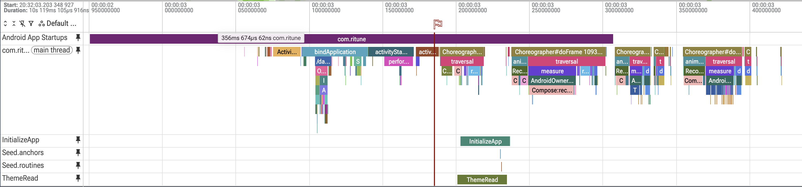
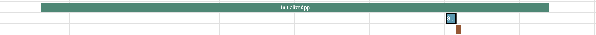

[← Performance home](../performance.md)

# Phase 1: cold-start trace

> Written up in the series as [Part 1](https://medium.com/@goyaltanvi94/ritune-takes-2-8-longer-to-start-on-a-mid-range-phone-here-is-how-i-found-where-the-time-goes-ee1453c9b3e2).

**40% of the Redmi's TTID passes before any Ritune code runs, and opening the Room database is most of what the splash waits for.**

One cold start per phone, recorded with [`perf/cold-start.pftxt`](../perf/cold-start.pftxt) and summarised with [`perf/cold-start.sql`](../perf/cold-start.sql). Release build, 2026-10-30. Compilation state: Redmi `speed-profile` (MIUI compiled it after the install), Pixel `verify`, so compare structure across phones, not absolute times.

Before the trace, four hypotheses were written down from reading the code, each with the check that would confirm it:

| # | Hypothesis | Check | Outcome |
|---|---|---|---|
| 1 | The splash puts all its waiting inside TTID, and that work starts late because `by viewModels()` is lazy | Start of `InitializeApp` vs end of `activityResume` | Confirmed: `InitializeApp` starts 14.7 ms after `activityResume` ends |
| 2 | TTFD is TTID plus all of Today's loading, because Today's queries can't start while the splash is up | Gap between TTID and the `reportFullyDrawn` slice | Confirmed: 83 ms (Redmi), 47 ms (Pixel) |
| 3 | Shortening one of the two splash waits barely helps | `InitializeApp` and `ThemeRead` side by side | Confirmed: both ~34 ms on the Redmi, in parallel |
| 4 | Compilation explains part of the gap, not all of it | Time before `bindApplication` | Confirmed: 40% of Redmi TTID |

| Milestone (ms from launch) | Redmi Note 10 Pro | Pixel 9 Pro |
|---|---|---|
| `bindApplication` starts | 144.4 | 72.0 |
| `activityStart` starts | 189.8 | 85.7 |
| `activityResume` ends | 237.9 | 107.4 |
| `ThemeRead` | 250.5 → 284.2 (33.7) | 115.6 → 124.0 (8.4) |
| `InitializeApp` | 252.5 → 286.4 (33.9) | 116.5 → 127.9 (11.4) |
| `Seed.anchors` starts | 279.5 | 127.1 |
| TTID | 356.7 | 151.8 |
| TTFD | 440.0 | 198.9 |
| TTID frame | 64.2 ms (3 missed at 60 Hz) | 20.3 ms (2 missed at 120 Hz) |

Findings:

- **Opening the Room database is most of `InitializeApp`:** 27 of 34 ms on the Redmi, 10.6 of 11.4 ms on the Pixel. Seeding an already-seeded database takes under 1 ms.
- **The startup work begins late.** Both ViewModels are created during the first `Choreographer#doFrame`, 61 ms (Redmi) and 30 ms (Pixel) after `activityStart` begins, because `by viewModels()` is lazy.
- **`ThemeRead` and `InitializeApp` take about the same time**, so shortening only one saves at most the 2–4 ms between them.
- **Today adds 83 ms (Redmi) and 47 ms (Pixel) between TTID and TTFD.** Its queries only start once Today is composed, after the splash ends. After TTID, Today needs two more frames: a 25 ms `Loading` frame and a 40 ms frame with the data.
- **The TTID frame is the most expensive frame:** 64 ms on the Redmi, half of it in `measure`, for the first composition of the app shell and Today.
- **40% of the Redmi's TTID passes before `bindApplication`**, while the system creates the process.
- Between 268 and 287 ms the Redmi's main thread draws nothing: the splash is still waiting.

---

← Previous: [Phase 0: manual cold start](phase-0-foundations.md) · Next: [Phase 2: Macrobenchmark](phase-2-macrobenchmark.md) → · [Performance home](../performance.md)
